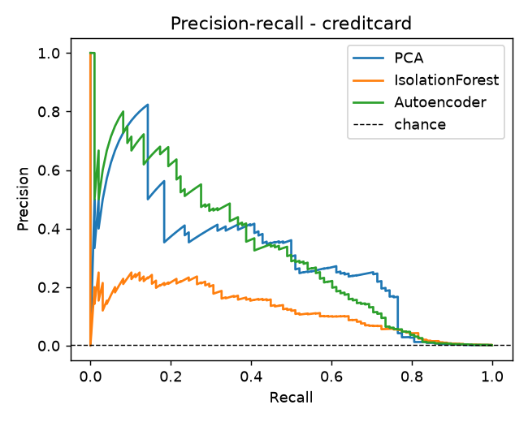
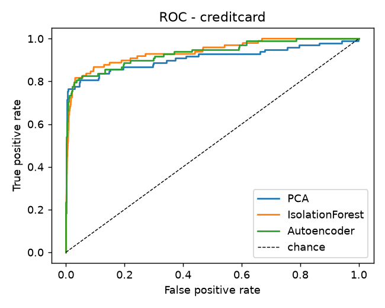

# Anomaly Detection: Autoencoder vs. Classical Baselines

[](https://github.com/anindya127/Anomaly-Detection-in-Data/actions/workflows/ci.yml)


A small, reproducible benchmark of a Keras **autoencoder** against **PCA** and **Isolation Forest** for
anomaly detection. It runs on a synthetic dataset and on the real
[ULB credit-card-fraud dataset](https://www.openml.org/d/1597) (284,807 transactions, 492 frauds = 0.173%).

The focus is **evaluation done correctly**: no label leakage, a threshold chosen on validation data only,
metrics that mean something on imbalanced data, and several random splits instead of one lucky run.

## Results

Test-set metrics, mean ± standard deviation over 5 random stratified splits (seeds 0-4).
The decision threshold maximises F1 on a separate validation set; the test set is never used to choose it.

### Credit-card fraud (real data, 0.173% fraud)

| Model | ROC-AUC | PR-AUC | Precision | Recall | F1 |
|---|---|---|---|---|---|
| PCA | 0.952 ± 0.025 | 0.401 ± 0.066 | 0.383 ± 0.053 | 0.590 ± 0.147 | 0.449 ± 0.027 |
| Isolation Forest | 0.957 ± 0.010 | 0.146 ± 0.015 | 0.244 ± 0.030 | 0.267 ± 0.027 | 0.254 ± 0.019 |
| **Autoencoder** | **0.960 ± 0.014** | **0.525 ± 0.112** | **0.594 ± 0.097** | 0.506 ± 0.091 | **0.542 ± 0.082** |

<p align="center">
  
  
</p>

**How to read this**

- **ROC-AUC barely separates the models** (0.952-0.960, within one standard deviation of each other). With 0.17%
  fraud, ROC-AUC is dominated by the huge normal class and looks good for almost any detector.
- **PR-AUC and F1 are the informative numbers.** The autoencoder is best (PR-AUC 0.525), PCA is second (0.401),
  and Isolation Forest is far behind (0.146).
- **The spread is large.** Each split's test set holds only about 98 frauds, so the autoencoder's PR-AUC varies
  by ±0.11 between splits. The autoencoder-over-PCA gap is suggestive, not proven; five seeds are too few
  for a significance claim.
- **Absolute quality is modest.** At the chosen threshold the best model has precision 0.59 and recall 0.51: it
  misses about half of the frauds, and about 4 in 10 alerts are false. This is a hard, heavily imbalanced problem.

### Synthetic data (9.1% anomalies)

10-feature Gaussians: normal ~ N(0, 1), anomalies ~ N(2, 2); 1,000 normal and 100 anomalous rows.

| Model | ROC-AUC | PR-AUC | Precision | Recall | F1 |
|---|---|---|---|---|---|
| PCA | 0.741 ± 0.074 | 0.477 ± 0.113 | 0.697 ± 0.232 | 0.300 ± 0.063 | 0.409 ± 0.090 |
| **Isolation Forest** | **1.000 ± 0.000** | **1.000 ± 0.001** | **0.972 ± 0.037** | **0.980 ± 0.040** | **0.975 ± 0.022** |
| Autoencoder | 0.993 ± 0.005 | 0.963 ± 0.021 | 0.885 ± 0.087 | 0.850 ± 0.158 | 0.852 ± 0.085 |

Here Isolation Forest wins and PCA struggles. A plausible reason (not tested here) is that the anomalies differ
by a mean shift and a wider spread, which trees isolate easily, whereas PCA keeps the high-variance directions
that anomalies share with normal data. The ranking differs from the credit-card data, so **no single model wins
everywhere**.

## Evaluation protocol

| Step | What is done |
|---|---|
| Split | Stratified train / validation / test = 60 / 20 / 20, repeated for seeds 0-4 |
| Training data | **Normal samples only.** Anomalies that fall in the training portion are dropped (semi-supervised setting) |
| Scaling | `StandardScaler` fitted on the training samples only |
| Threshold | Maximises F1 on the **validation** set; a row is flagged when `score >= threshold` |
| Metrics | ROC-AUC, PR-AUC (average precision), precision, recall, F1 on the **test** set |
| Features (credit card) | V1-V28 plus `log1p(Amount)`. The raw `Time` column is dropped |

The validation set contains labelled anomalies, so this setting assumes a small labelled sample is available
for choosing the threshold. Fully unsupervised use would need a different rule, for example a percentile of the
training reconstruction error.

## Models

- **Autoencoder** (`anomaly_detection/models.py`): dense encoder-decoder (64-32-latent-32-64, latent size = half
  the input width) with ReLU and a **linear** output layer, trained with MSE on normal data with early stopping.
  The anomaly score is the per-row reconstruction error.
- **PCA**: keeps the components explaining 90% of the variance; the score is the reconstruction error.
- **Isolation Forest**: 200 trees; the score is the negated `score_samples`.

## Quick start

```bash
git clone https://github.com/anindya127/Anomaly-Detection-in-Data.git
cd Anomaly-Detection-in-Data
python -m venv .venv && source .venv/bin/activate
pip install -e ".[dev,tf]"

pytest -q                                                 # 22 tests
python -m anomaly_detection synthetic                     # a few minutes on CPU
python -m anomaly_detection creditcard                    # downloads 150 MB once; about 10 minutes on CPU
python -m anomaly_detection creditcard --no-autoencoder   # classical baselines only, seconds
```

Results are written to `results/<dataset>.json` (every per-seed number) and `results/<dataset>.md` (the table).
On a 4-core CPU with no GPU, the autoencoder's fit on the credit-card data averaged 121 s per split.

## Project layout

```
anomaly_detection/
  data.py        synthetic generator, credit-card loader, leak-free split
  models.py      Autoencoder, PCA and Isolation Forest detectors (fit / score)
  metrics.py     F1-optimal threshold and metrics
  benchmark.py   multi-seed runner and results table
  plots.py       ROC and precision-recall figures
  cli.py         command line entry point
tests/           22 tests: splits, metrics, models, benchmark
legacy/          the original single-file script, kept for reference
results/         measured results (JSON + Markdown)
docs/            figures
```

## What changed from the original version

The first version of this repository was a single script. Its README quoted
`Accuracy: 0.95`, `True anomalies detected: 95/100`, `False positives: 5/900`. **Those numbers cannot be
produced by the code**: with the script's own split the test set has 16 anomalies and 204 normal rows, not 100
and 900. Running the original script on my machine printed:

```
Accuracy: 0.98
True anomalies detected: 11/16
False positives: 0/204
```

(The script seeds NumPy but not TensorFlow, so the exact counts can differ slightly between runs.)

The 0.98 is misleading. The script flags the top 5% of test errors by construction (the threshold is the 95th
percentile of the *test* errors), so it can flag at most 11 of 220 rows; it caught 11 of 16 anomalies (69%
recall), and accuracy is inflated by the 93% normal class. The rewrite fixes these problems:

1. The autoencoder was trained on data that contained anomalies; it now trains on normal data only.
2. The threshold came from test-set errors (leakage); it is now chosen on a separate validation set.
3. The output layer was `sigmoid` (range 0-1) while inputs were standardised and go negative; it is now linear.
4. Accuracy on an imbalanced problem hides failures; the benchmark now reports ROC-AUC, PR-AUC, precision,
   recall and F1.
5. There were no baselines; PCA and Isolation Forest are included.
6. Results came from one split; they are now averaged over five.
7. There were no tests or CI; there are now 22 tests and a GitHub Actions workflow.

The original script is preserved in [`legacy/`](legacy/).

## Limitations

- Five seeds and about 98 test frauds per split: differences smaller than roughly 0.1 PR-AUC should not be
  over-interpreted.
- No hyperparameter search. Architecture, PCA variance and forest size are fixed defaults, and the baselines
  could also improve with tuning.
- The credit-card features V1-V28 are already PCA-transformed by the dataset's authors, which limits what
  feature engineering and the PCA baseline can show.
- A random split ignores time order; a real fraud system would validate on later transactions.
- The dataset covers a single two-day window of European card transactions.

## Dataset citation

Dal Pozzolo, A., Caelen, O., Johnson, R. A., Bontempi, G. *Calibrating Probability with Undersampling for
Unbalanced Classification.* IEEE CIDM, 2015. Data from the ULB Machine Learning Group.

## License

MIT, see [LICENSE](LICENSE).
